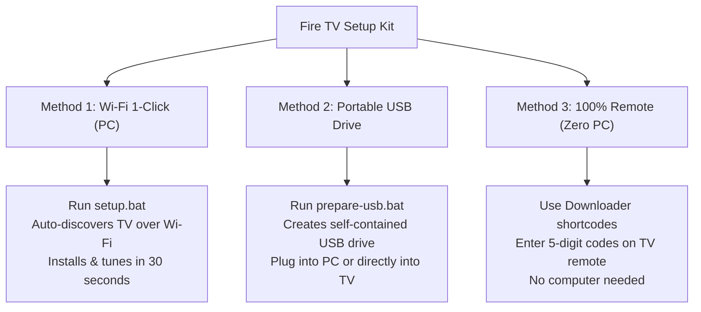

# 🔥 Fire TV Ultimate Setup Kit

[](https://amazon.com)
[](https://stremio.com)
[](https://github.com/yuliskov/SmartTube)
[](https://tivimate.com)
[](https://adguard-dns.io)
[](LICENSE)

An automated, turnkey setup kit and recovery toolkit for Amazon Fire TV (Cube, Stick, Fire TV Edition) and Android TV devices. Configures the "Big 3" streaming apps (**Stremio**, **SmartTube**, and **TiviMate**), activates native system-wide ad/tracker blocking via encrypted DNS over TLS (DoT), eliminates Amazon telemetry bloat, and permanently fixes the Stremio ExoPlayer decoder deadlock (the infamous "trailer restart" bug).

---

## ⚡ What This Kit Does Automatically

1. **📦 The "Big 3" Streaming Stack:**
   * **Stremio (Android TV Edition):** High-speed peer-to-peer streaming with Torrentio integration.
   * **SmartTube:** 4K/60fps HDR YouTube playback with SponsorBlock, ad-blocking, and background audio.
   * **TiviMate:** Premium-grade IPTV player with EPG timeline and multi-screen support.
2. **🛡️ Zero-Middleman Ad-Blocking (AdGuard DNS over TLS):**
   * Configures native Android Private DNS (`dns.adguard-dns.com` over port 853).
   * Blocks advertisements, telemetry, and malicious domains system-wide.
   * **No VPN app required, no PC middleman needed.** The TV functions 100% independently whether your computer is on or off.
3. **⚡ The Stremio "Trailer Bug" Fix:**
   * Disables **Tunnelled Playback** to prevent ExoPlayer hardware decoder deadlocks during P2P buffer pauses.
   * Disables **Frame Rate Matching** to prevent 3–5 second HDMI display mode handshake drops.
   * Sets **Torrent Profile** to **Ultra Fast** for rapid chunk buffering and peer negotiation.
4. **🧹 Safe Performance Debloat:**
   * Disables background Amazon retail demos, shopping services, and telemetry without breaking remote control, Alexa voice, audio, Wi-Fi, or Bluetooth.

---

## 🚀 3 Ways to Deploy



---

### Method 1: 1-Click Wi-Fi Setup (Fastest & Recommended)

Set up any Fire TV on your home Wi-Fi in 30 seconds without touching the TV remote.

1. Ensure **ADB Debugging** is enabled on your Fire TV:
   * **Settings** -> **My Fire TV** -> **Developer Options** -> **ADB Debugging** -> `ON`.
   * *(If Developer Options is hidden: Settings -> My Fire TV -> About -> click the device name 7 times rapidly).*
2. Double-click **`setup.bat`** on your Windows PC (or run `./setup.sh` on macOS/Linux).
3. Select your TV (e.g. Downstairs Fire TV Cube, Upstairs TV, or Auto-Scan).
4. Choose **`[1] Express 1-Click Setup`**.
5. Done! The TV will be updated, debloated, and optimized automatically.

---

### Method 2: Portable USB Flash Drive Toolkit

Carry the entire installer toolkit on a physical thumb drive:

1. Insert any USB flash drive into your computer.
2. Double-click **`prepare-usb.bat`**.
3. Enter the drive letter (e.g. `E:`). The script will format and populate the USB drive with:
   * `INSTALL_ON_PC.bat` (Run from any PC on the network to flash any TV)
   * `apks/` containing all 3 verified APKs
   * `tools/` with portable ADB
   * Direct-on-TV installation instructions
4. **How to use the USB drive:**
   * **On any PC:** Plug in the USB and double-click `INSTALL_ON_PC.bat`.
   * **Directly on Fire TV Cube / OTG Cable:** Plug the USB directly into the TV's USB port, open any file manager (Downloader or Total Commander), open `USB Drive > apks`, and install. See [docs/DIRECT_USB_SETUP.md](docs/DIRECT_USB_SETUP.md).

---

### Method 3: 100% Remote Control (Zero PC / Zero USB)

If you are away from your computer and setting up a brand-new Fire TV from scratch:

1. Install **Downloader** from the Amazon Appstore.
2. In the URL bar, enter any of these 5-digit shortcodes:
   * **SmartTube:** `28544`
   * **Stremio:** `81044`
   * **TiviMate:** `272483`
3. In Stremio, go to **Settings** -> **Playback** -> Turn **Tunnelled Playback** `OFF`.
4. Detailed step-by-step instructions: [docs/DOWNLOADER_SHORTCODES.md](docs/DOWNLOADER_SHORTCODES.md).

---

## 📂 Project Structure

```text
firetv-setup-kit/
├── setup.bat                     # 1-Click Windows launcher
├── setup.sh                      # macOS / Linux bash runner
├── prepare-usb.bat               # Interactive USB drive creator
├── README.md                     # Documentation & quick start guide
├── LICENSE                       # MIT License
├── apks/                         # Bundled, verified APK packages
│   ├── stremio-tv.apk            # Stremio Android TV edition
│   ├── smarttube.apk             # SmartTube 4K ad-free YouTube
│   └── tivimate.apk              # TiviMate IPTV Player
├── tools/                        # Portable Android platform tools
│   ├── adb.exe                   # Official Android Debug Bridge
│   ├── AdbWinApi.dll             # ADB Windows subsystem library
│   └── AdbWinUsbApi.dll          # ADB USB subsystem library
├── scripts/                      # Core automation scripts
│   ├── setup.ps1                 # Interactive setup engine & network scanner
│   └── prepare-usb.ps1           # USB drive packaging script
└── docs/                         # Technical documentation
    ├── OPTIMIZATIONS_EXPLAINED.md# Engineering details on the trailer bug & DoT
    ├── DOWNLOADER_SHORTCODES.md  # 5-digit codes for zero-PC setup
    └── DIRECT_USB_SETUP.md       # Fire TV Cube USB & OTG instructions
```

---

## 🛠️ Stremio Optimization Summary

| Setting | Factory Default | Optimized Value | Technical Purpose |
| :--- | :--- | :--- | :--- |
| **Tunnelled Playback** | `Enabled` | **`Disabled`** | Permanently eliminates ExoPlayer hardware sink deadlocks (stops trailer restart bug). |
| **Frame Rate Matching** | `Frame Rate only` | **`Disabled`** | Prevents 3–5s HDMI display mode handshake blackouts and crashes. |
| **Hardware-Accelerated Decoding** | `Enabled` | **`Enabled`** | Retains full GPU decoding for smooth 4K/60fps playback without CPU throttling. |
| **Torrent Profile** | `Default` | **`Ultra Fast`** | Optimizes peer limits and chunk buffering for near-instant stream start times. |

---

## ❓ Frequently Asked Questions (FAQ)

### Does my PC need to be turned on when streaming?
**No.** All applications, settings, and DNS configurations are stored natively inside the Fire TV's internal memory. Once setup finishes, you can turn off your computer entirely.

### What causes the "missing middleman" error?
Previous setups ran a local VPN app (such as `dnsfilter.android`) or relied on a PC running a proxy. If the app or PC crashed, the VPN interface stalled all traffic. This kit configures Fire OS's built-in **Private DNS over TLS** (`dns.adguard-dns.com`), which talks directly to cloud resolvers with zero software running on the TV.

### What streams should I pick in Stremio for best results?
When using free peer-to-peer streaming:
* Look for files with **30–50+ seeders** (indicated by the 👤 icon).
* Aim for files between **2 GB – 8 GB** (1080p or high-efficiency 4K).
* Avoid 50 GB+ uncompressed Blu-ray remuxes unless they have very high seed counts.

---

## 📜 License
Released under the [MIT License](LICENSE).
