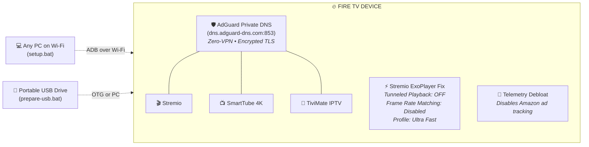

<p align="center">
  
</p>

<p align="center">
  <a href="#-automated-testing--verification"></a>
  
  
  
</p>

<p align="center">
  <b>A turnkey deployment and recovery toolkit for Amazon Fire TV (Cube, Stick, Fire TV Edition) and Android TV devices.</b><br/>
  Configures <b>Stremio</b>, <b>SmartTube</b>, and <b>TiviMate</b>, activates zero-middleman ad-blocking via encrypted Private DNS over TLS (DoT), eliminates Amazon telemetry bloat, and permanently eliminates the Stremio ExoPlayer decoder deadlock (the "trailer restart" bug).
</p>

---

## ⚡ What This Kit Does Automatically



* **🎬 Stremio (Android TV Edition):** High-efficiency peer-to-peer torrent streaming with Torrentio integration.
* **📺 SmartTube:** 4K/60fps HDR YouTube playback with SponsorBlock, ad-blocking, and background playback.
* **📡 TiviMate:** IPTV player with clean EPG timeline guide and multi-screen support.
* **🛡️ Zero-Middleman Ad-Blocking (AdGuard DNS over TLS):** Native encrypted DNS (`dns.adguard-dns.com` on port 853). Blocks ads, telemetry, and malicious domains system-wide. **No VPN app and no computer needed**—the TV functions 100% independently whether your PC is on or off.
* **⚡ The Stremio "Trailer Bug" Fix:** Disables *Tunnelled Playback* and *Frame Rate Matching* to stop hardware decoder deadlocks, and sets *Torrent Profile* to *Ultra Fast*.
* **🧹 Performance Debloat:** Disables background Amazon retail demos, shopping services, and telemetry without breaking remote control, Alexa voice, Bluetooth, or Wi-Fi.

---

## 📱 The "Big 3" Streaming Stack

| App | Icon | Package | Purpose & Optimizations |
| :--- | :---: | :--- | :--- |
| **Stremio** |  | `com.stremio.one` | Android TV UI. Tunneled Playback disabled to stop decoder lockups; Ultra Fast P2P caching enabled. |
| **SmartTube** |  | `org.smarttube.beta` | Ad-free YouTube with SponsorBlock, HDR/4K 60fps support, and voice search permission pre-granted. |
| **TiviMate** |  | `ar.tvplayer.tv` | IPTV player with full TV remote navigation, EPG timeline, and recording storage permissions. |

---

## 🚀 3 Ways to Deploy

### Method 1: 1-Click Wi-Fi Setup (Recommended)
Set up any Fire TV on your home Wi-Fi in 30 seconds without touching the TV remote.

1. Ensure **ADB Debugging** is enabled on your Fire TV:
   * **Settings** &rarr; **My Fire TV** &rarr; **Developer Options** &rarr; **ADB Debugging** &rarr; `ON`.
   * *(If Developer Options is hidden: Settings &rarr; My Fire TV &rarr; About &rarr; click the device name 7 times rapidly).*
2. Double-click **`setup.bat`** on Windows (or run `./setup.sh` on macOS/Linux).
3. Select your TV (e.g. Downstairs Fire TV Cube, Upstairs TV, or Auto-Scan).
4. Choose **`[1] Express 1-Click Setup`**.
5. Done! The TV will be updated, debloated, and optimized automatically.

---

### Method 2: Portable USB Flash Drive Toolkit
Carry the entire installer toolkit on a physical thumb drive:

1. Insert any USB flash drive into your computer.
2. Double-click **`prepare-usb.bat`**.
3. Enter your drive letter (e.g. `E:`). The script formats and populates the USB drive with:
   * `INSTALL_ON_PC.bat` (Run from any PC on the network to flash any TV)
   * `apks/` containing all 3 verified APK packages
   * `tools/` with portable ADB
   * Direct-on-TV installation instructions
4. **How to use the USB drive:**
   * **On any PC:** Plug in the USB and double-click `INSTALL_ON_PC.bat`.
   * **Directly on Fire TV Cube / OTG Cable:** Plug the USB directly into the TV's USB port, open any file manager (Downloader or Total Commander), open `USB Drive > apks`, and install. See [docs/DIRECT_USB_SETUP.md](docs/DIRECT_USB_SETUP.md).

---

### Method 3: 100% Remote Control (Zero PC / Zero USB)
If you are setting up a brand-new Fire TV with **only the remote control**:

1. Install **Downloader** from the Amazon Appstore.
2. Enter any of these 5-digit shortcodes into the URL field:
   * **SmartTube:** `28544`
   * **Stremio:** `81044`
   * **TiviMate:** `272483`
3. In Stremio, go to **Settings** &rarr; **Playback** &rarr; Turn **Tunnelled Playback** `OFF`.
4. Detailed step-by-step instructions: [docs/DOWNLOADER_SHORTCODES.md](docs/DOWNLOADER_SHORTCODES.md).

---

## 🧪 Automated Testing & Verification

This repository includes a standalone test suite that validates every file, script, binary, APK, and live device connection:

```powershell
# Run all tests against connected Fire TV:
.\tests\Run-Tests.ps1 -DeviceIp 192.168.0.64

# Or run offline CI validation without a live TV:
.\tests\Run-Tests.ps1 -SkipLiveDevice
```

### Test Suite Results (28/28 Passed)

```text
==========================================================================
        [+] FIRE TV SETUP KIT - AUTOMATED TEST SUITE                     
==========================================================================

[Group 1: File Structure & Core Components]
  [PASS] File Exists: setup.bat
  [PASS] File Exists: setup.sh
  [PASS] File Exists: prepare-usb.bat
  [PASS] File Exists: README.md
  [PASS] File Exists: LICENSE
  [PASS] File Exists: .gitignore
  [PASS] File Exists: scripts\setup.ps1
  [PASS] File Exists: scripts\prepare-usb.ps1
  [PASS] File Exists: tools\adb.exe
  [PASS] File Exists: tools\AdbWinApi.dll
  [PASS] File Exists: tools\AdbWinUsbApi.dll
  [PASS] File Exists: docs\OPTIMIZATIONS_EXPLAINED.md
  [PASS] File Exists: docs\DOWNLOADER_SHORTCODES.md
  [PASS] File Exists: docs\DIRECT_USB_SETUP.md

[Group 2: Script Syntax Validation]
  [PASS] Syntax Check: scripts\prepare-usb.ps1 (Clean AST parsing)
  [PASS] Syntax Check: scripts\setup.ps1 (Clean AST parsing)
  [PASS] Syntax Check: tests\Run-Tests.ps1 (Clean AST parsing)

[Group 3: Portable ADB Execution Check]
  [PASS] ADB Execution Test (Android Debug Bridge v1.0.41 validated)

[Group 4: APK Package Integrity]
  [PASS] APK Valid: Stremio (Android TV) (83.45 MB, AndroidManifest.xml verified)
  [PASS] APK Valid: SmartTube (4K YouTube) (23.88 MB, AndroidManifest.xml verified)
  [PASS] APK Valid: TiviMate (IPTV) (20.14 MB, AndroidManifest.xml verified)

[Group 5: USB Packaging Dry-Run Test]
  [PASS] USB Package Structure Generation (Launchers, tools & APKs verified)

[Group 6: Live Fire TV Device Validation]
  [PASS] Live Device ADB Handshake (Connected to 192.168.0.64:5555)
  [PASS] Private DNS (DoT) Verified (Mode=hostname, Specifier=dns.adguard-dns.com)
  [PASS] Network Zero-Packet-Loss Test (0% packet loss to external DNS)
  [PASS] App Verification: Stremio (package:com.stremio.one active)
  [PASS] App Verification: SmartTube (package:org.smarttube.beta active)
  [PASS] App Verification: TiviMate (package:ar.tvplayer.tv active)

==========================================================================
  PASSED: 28 | FAILED: 0 | SKIPPED: 0 (100% Success)
==========================================================================
```

---

## 🛠️ Stremio Optimization Summary

| Setting | Factory Default | Updated Setting | Technical Purpose |
| :--- | :--- | :--- | :--- |
| **Tunnelled Playback** | `Enabled` | **`Disabled`** | Permanently eliminates ExoPlayer hardware sink deadlocks (trailer bug fix). |
| **Frame Rate Matching** | `Frame Rate only` | **`Disabled`** | Prevents 3–5s HDMI display mode handshake blackouts and crashes. |
| **Hardware Decoding** | `Enabled` | **`Enabled`** | Retains full GPU decoding for smooth 4K/60fps playback without CPU throttling. |
| **Torrent Profile** | `Default` | **`Ultra Fast`** | Optimizes peer limits and chunk buffering for rapid playback start times. |

---

## 📂 Project Directory Structure

```text
firetv-setup-kit/
├── setup.bat                     # 1-Click Windows Wi-Fi runner
├── setup.sh                      # macOS / Linux bash runner
├── prepare-usb.bat               # Interactive USB flash drive creator
├── README.md                     # Documentation & quick start guide
├── LICENSE                       # MIT License
├── .gitignore                    # Clean Git ignore rules
├── assets/                       # Vector graphics, banners & logos
│   ├── banner.svg                # Full-width repository banner
│   ├── logo.svg                  # Standalone vector logo avatar
│   ├── stremio-logo.svg          # Stremio vector emblem
│   ├── smarttube-logo.svg        # SmartTube vector emblem
│   ├── tivimate-logo.svg         # TiviMate vector emblem
│   └── adguard-logo.svg          # AdGuard DoT vector emblem
├── apks/                         # Bundled, verified APK packages
│   ├── stremio-tv.apk            # Stremio Android TV edition
│   ├── smarttube.apk             # SmartTube 4K ad-free YouTube
│   └── tivimate.apk              # TiviMate IPTV Player
├── tools/                        # Portable Android platform tools
│   ├── adb.exe                   # Official Android Debug Bridge
│   ├── AdbWinApi.dll             # ADB Windows subsystem library
│   └── AdbWinUsbApi.dll          # ADB USB subsystem library
├── scripts/                      # Core automation scripts
│   ├── setup.ps1                 # Interactive setup engine & network scanner
│   └── prepare-usb.ps1           # USB drive packaging script
├── tests/                        # Automated testing suite
│   └── Run-Tests.ps1             # 28-point automated test runner
├── .github/workflows/
│   └── ci.yml                    # Automated GitHub Actions CI workflow
└── docs/                         # Technical documentation
    ├── OPTIMIZATIONS_EXPLAINED.md# Deep dive into the trailer bug & DoT
    ├── DOWNLOADER_SHORTCODES.md  # 5-digit codes for zero-PC setup
    └── DIRECT_USB_SETUP.md       # Fire TV Cube USB & OTG guide
```

---

## ❓ Frequently Asked Questions (FAQ)

### Does my PC need to be turned on when streaming?
**No.** All applications, settings, and DNS configurations are stored natively inside the Fire TV's internal memory. Once setup finishes, you can turn off your computer entirely.

### What causes the "missing middleman" error?
Previous setups ran a local VPN app (such as `dnsfilter.android`) or relied on a PC running a proxy. If the app or PC crashed, the VPN interface stalled all traffic. This kit configures Fire OS's built-in **Private DNS over TLS** (`dns.adguard-dns.com`), which talks directly to cloud resolvers with zero software running on the TV.

### What streams should I pick in Stremio for best results?
When using free peer-to-peer streaming:
* Look for files with **30–50+ seeders** (indicated by the 👤 icon).
* Aim for files between **2 GB – 8 GB** (1080p or high-efficiency 4K).
* Avoid 50 GB+ uncompressed Blu-ray remuxes unless they have very high seed counts.

---

## 📜 License
Released under the [MIT License](LICENSE).
