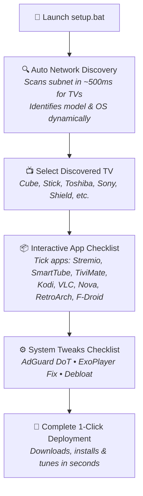

<p align="center">
  
</p>

<p align="center">
  <a href="#-automated-testing--verification"></a>
  
  
  
</p>

<p align="center">
  <b>A turnkey deployment and recovery toolkit for Amazon Fire TV (Cube, Stick, Fire TV Edition) and Android TV devices.</b><br/>
  Auto-discovers any TV on any Wi-Fi network, presents an interactive checklist of curated streaming &amp; utility apps, activates zero-middleman ad-blocking via encrypted Private DNS over TLS (DoT), eliminates Amazon telemetry bloat with rollback snapshots, provides hardware/screen diagnostics, and permanently fixes the Stremio ExoPlayer decoder deadlock (the "trailer restart" bug).
</p>

---

## ⚡ What This Kit Does Automatically



* **🔍 Automatic TV Network Discovery:** Zero hardcoded device names. Runs a high-speed ~500ms subnet probe across whatever Wi-Fi network you are connected to. Queries and identifies the exact model (e.g. Fire TV Cube, Stick 4K Max, Toshiba Fire TV, Google Chromecast, Nvidia Shield) with its IP and OS version.
* **☑️ Interactive App Checklist:** Choose which apps to install using a toggle checklist in the console. Pick from our curated, verified catalog of streaming, utility, and media apps.
* **🛡️ Zero-Middleman Ad-Blocking (AdGuard DNS over TLS):** Native encrypted DNS (`dns.adguard-dns.com` on port 853). Blocks ads, telemetry, and malicious domains system-wide. **No VPN app and no computer needed**—the TV functions 100% independently whether your PC is on or off.
* **⚡ The Stremio "Trailer Bug" Fix:** Disables *Tunnelled Playback* and *Frame Rate Matching* in ExoPlayer to stop hardware decoder deadlocks, and sets *Torrent Profile* to *Ultra Fast*.
* **🧹 Performance Debloat:** Disables background Amazon retail demos, shopping services, and telemetry without breaking remote control, Alexa voice, Bluetooth, or Wi-Fi.

---

## 📦 Curated App Catalog (Interactive Checklist)

| App | Icon | Package | Status | Description & Purpose |
| :--- | :---: | :--- | :---: | :--- |
| **Stremio** |  | `com.stremio.one` | **Pre-Bundled** | Android TV UI. Movies & TV via P2P (ExoPlayer trailer deadlock fix pre-applied). |
| **SmartTube** |  | `org.smarttube.beta` | **Pre-Bundled** | 4K/60fps HDR YouTube playback with SponsorBlock, ad-blocking & background audio. |
| **TiviMate** |  | `ar.tvplayer.tv` | **Pre-Bundled** | IPTV player with TV remote navigation, multi-screen, and EPG timeline guide. |
| **Kodi 21 (Omega)** | 🎬 | `org.xbmc.kodi` | **Auto-Download** | Modular open-source home theater, local media libraries & community addons. |
| **VLC for Android TV** | 🚦 | `org.videolan.vlc` | **Auto-Download** | Universal media player for all USB drives and local network shares (SMB/NFS). |
| **Nova Video Player** | 🌟 | `org.courville.nova` | **Auto-Download** | Open-source Android TV player with automatic movie poster & metadata scraper. |
| **RetroArch** | 🕹️ | `com.retroarch.ra32` | **Auto-Download** | All-in-one retro gaming console & arcade emulator (NES, SNES, PS1, GBA, N64). |
| **F-Droid Store** | 📱 | `org.fdroid.fdroid` | **Auto-Download** | Independent open-source application repository for TV. |

---

## 🚀 3 Ways to Deploy

### Method 1: 1-Click Wi-Fi Setup (Recommended)
Set up any TV on any home, friend's, or hotel Wi-Fi in 30 seconds without touching the TV remote.

1. Ensure **ADB Debugging** is enabled on your Fire TV or Android TV:
   * **Settings** &rarr; **My Fire TV** &rarr; **Developer Options** &rarr; **ADB Debugging** &rarr; `ON`.
   * *(If Developer Options is hidden: Settings &rarr; My Fire TV &rarr; About &rarr; click the device name 7 times rapidly).*
2. Double-click **`setup.bat`** on Windows (or run `./setup.sh` on macOS/Linux).
3. The script automatically scans the network and displays all discovered TVs:
   ```text
   ==========================================================================
                   DISCOVERING SMART TVS ON YOUR WI-FI
   ==========================================================================
   [*] Scanning network (192.168.0.1 - 192.168.0.254)...

   [+] Found 2 Smart TV(s):
     [1] Amazon Fire TV Cube (3rd Gen) [192.168.0.64] - Fire OS 7.7.1
     [2] Toshiba 4K UHD Fire TV Edition [192.168.0.140] - Fire OS 7.7.1
     [M] Enter custom IP address manually
     [R] Rescan network
   ```
4. Choose your TV, tick the apps you want on the checklist, and hit Enter. Done!

---

### Method 2: Portable USB Flash Drive Toolkit
Carry the entire installer toolkit on a physical thumb drive:

1. Insert any USB flash drive into your computer.
2. Double-click **`prepare-usb.bat`**.
3. Enter your drive letter (e.g. `E:`). The script formats and populates the USB drive with:
   * `INSTALL_ON_PC.bat` (Run from any PC on the network to flash any TV)
   * `apks/` containing pre-verified APK packages
   * `tools/` with portable ADB
   * Direct-on-TV installation instructions
4. **How to use the USB drive:**
   * **On any PC:** Plug in the USB and double-click `INSTALL_ON_PC.bat`.
   * **Directly on Fire TV Cube / OTG Cable:** Plug the USB directly into the TV's USB port, open any file manager (Downloader or Total Commander), open `USB Drive > apks`, and install. See [docs/DIRECT_USB_SETUP.md](docs/DIRECT_USB_SETUP.md).

---

### Method 3: 100% Remote Control (Zero PC / Zero USB)
If you are setting up a brand-new Fire TV with **only the remote control**:

1. Install **Downloader** from the Amazon Appstore.
2. Enter any of these 5-digit shortcodes into the URL field:
   * **SmartTube:** `28544`
   * **Stremio:** `81044`
   * **TiviMate:** `272483`
3. In Stremio, go to **Settings** &rarr; **Playback** &rarr; Turn **Tunnelled Playback** `OFF`.
4. Detailed step-by-step instructions: [docs/DOWNLOADER_SHORTCODES.md](docs/DOWNLOADER_SHORTCODES.md).

---

## 🧪 Automated Testing & Verification

This repository includes a standalone test suite that validates every file, script, binary, APK, and live device connection:

```powershell
# Run all tests against connected Fire TV:
.\tests\Run-Tests.ps1 -DeviceIp 192.168.0.64

# Or run offline CI validation without a live TV:
.\tests\Run-Tests.ps1 -SkipLiveDevice
```

### ⚡ Advanced CLI & Automation Switches

```powershell
# 1. Run full device display & hardware diagnostics:
.\scripts\setup.ps1 -TargetIP 192.168.0.64 -Diagnostics

# 2. Deploy with custom DNS provider (AdGuard, AdGuardFamily, Cloudflare, Quad9):
.\scripts\setup.ps1 -TargetIP 192.168.0.64 -DnsProfile Cloudflare -Express

# 3. Export TV configuration profile to JSON:
.\scripts\setup.ps1 -TargetIP 192.168.0.64 -ExportProfilePath .\living-room-tv.json

# 4. Clone / import configuration to another TV:
.\scripts\setup.ps1 -TargetIP 192.168.0.120 -ImportProfilePath .\living-room-tv.json

# 5. Restore / rollback disabled bloatware packages:
.\scripts\setup.ps1 -TargetIP 192.168.0.64 -RestoreDebloat
```

---

## 🛠️ Stremio Optimization Summary

| Setting | Factory Default | Updated Setting | Technical Purpose |
| :--- | :--- | :--- | :--- |
| **Tunnelled Playback** | `Enabled` | **`Disabled`** | Permanently eliminates ExoPlayer hardware sink deadlocks (trailer bug fix). |
| **Frame Rate Matching** | `Frame Rate only` | **`Disabled`** | Prevents 3–5s HDMI display mode handshake blackouts and crashes. |
| **Hardware Decoding** | `Enabled` | **`Enabled`** | Retains full GPU decoding for smooth 4K/60fps playback without CPU throttling. |
| **Torrent Profile** | `Default` | **`Ultra Fast`** | Optimizes peer limits and chunk buffering for rapid playback start times. |

---

## 📂 Project Directory Structure

```text
firetv-setup-kit/
├── setup.bat                     # 1-Click Windows Wi-Fi runner
├── setup.sh                      # macOS / Linux bash runner
├── prepare-usb.bat               # Interactive USB flash drive creator
├── README.md                     # Documentation & quick start guide
├── LICENSE                       # MIT License
├── CONTRIBUTING.md               # Contribution guidelines
├── .gitignore                    # Clean Git ignore rules
├── assets/                       # Vector graphics, banners & logos
│   ├── banner.svg                # Full-width vector repository banner
│   ├── banner.png                # High-res cinematic render banner
│   ├── logo.svg                  # Standalone vector logo avatar
│   ├── stremio-logo.svg          # Stremio vector emblem
│   ├── smarttube-logo.svg        # SmartTube vector emblem
│   ├── tivimate-logo.svg         # TiviMate vector emblem
│   └── adguard-logo.svg          # AdGuard DoT vector emblem
├── apks/                         # Pre-bundled, verified APK packages
│   ├── stremio-tv.apk            # Stremio Android TV edition
│   ├── smarttube.apk             # SmartTube 4K ad-free YouTube
│   └── tivimate.apk              # TiviMate IPTV Player
├── tools/                        # Portable Android platform tools
│   ├── adb.exe                   # Official Android Debug Bridge
│   ├── AdbWinApi.dll             # ADB Windows subsystem library
│   └── AdbWinUsbApi.dll          # ADB USB subsystem library
├── scripts/                      # Core automation scripts
│   ├── setup.ps1                 # Discovery engine & interactive app checklist
│   └── prepare-usb.ps1           # USB drive packaging script
├── tests/                        # Automated testing suite
│   └── Run-Tests.ps1             # 28-point automated test runner
├── .github/workflows/
│   └── ci.yml                    # Automated GitHub Actions CI workflow
└── docs/                         # Technical documentation
    ├── OPTIMIZATIONS_EXPLAINED.md# Deep dive into the trailer bug & DoT
    ├── DOWNLOADER_SHORTCODES.md  # 5-digit codes for zero-PC setup
    └── DIRECT_USB_SETUP.md       # Fire TV Cube USB & OTG guide
```

---

## 📜 License
Released under the [MIT License](LICENSE).
